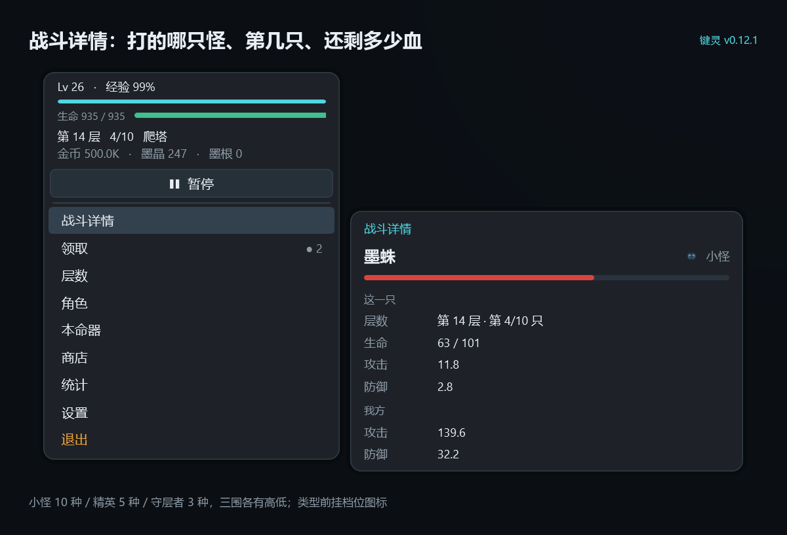

# 键灵 KeySpirit

一个**只有托盘图标、没有窗口**的 Windows 挂机小游戏。

挂机自动打塔、自动变强；想看进度就右键托盘里的墨滴图标——弹出的是一块**仿 Windows 右键菜单**的面板（不是网页、不是新窗口），鼠标悬停展开子菜单，领取奖励、升装备、买东西、看数值都在里面点完。全程零弹窗、零任务栏按钮，挂后台基本感知不到。



---

## 下载

到 [**Releases**](../../releases/latest) 页面下载 `KeySpirit-v0.14.0-win-x64.zip`，解压后双击 `KeySpirit.exe` 即可。

- **免安装、绿色版**：不用装 .NET，解压即跑（自包含单文件）
- 系统要求：**Windows 10 / 11 x64**
- 启动后不会出现窗口，只在托盘多一个墨滴图标

## 怎么玩

| 操作 | 说明 |
|---|---|
| 右键 / 左键点托盘图标 | 菜单从光标处弹出（放不下会向上、向左翻） |
| 悬停某一项 0.24 秒 | 子菜单自动展开，再点一下收起 |
| 悬停某一行 1.5 秒 | 弹出这条按钮的注释气泡（设置 / 本命器 / 转生），置灰的也能看 |
| 第一项「▶ 开始战斗 / ❚❚ 暂停」 | 一键停 |
| 悬停托盘图标 | 出只读小提示：层数 / HP / 状态 / 待领 |
| 敲键盘 | 每 300 次掉一个金币袋（设置里可关） |

核心循环很简单：**打怪 → 金币 → 买墨晶 → 强化本命四器 → 打更高的层**。打不动了就转生，换永久属性「墨根」重开一轮。

转生的界线是**「能不能带走」**：金币、墨晶、待领金币袋清零（现金），四件本命器强化等级与墨根保留（已经变成永久强度的投入）。所以转生前把墨晶喂光才是正解。

## 存档与日志

```
%LocalAppData%\KeySpirit\
  save.json          存档（每 30 秒自动存，也可手动存）
  key spirit.log     运行日志
```

删掉 `save.json` 就是重开。设置里有「打开存档目录」。

## 从源码构建

需要 [.NET 8 SDK](https://dotnet.microsoft.com/download)。

```bash
# 调试运行
dotnet run --project src/KeySpirit/KeySpirit.csproj

# 框架依赖发布（体积小，需要装 .NET 8 Desktop Runtime）
dotnet publish src/KeySpirit/KeySpirit.csproj -c Release -o dist/KeySpirit

# 自包含单文件（Release 里用的就是这个，约 67MB，免装 .NET）
dotnet publish src/KeySpirit/KeySpirit.csproj -c Release -r win-x64 --self-contained true \
  -p:PublishSingleFile=true -p:IncludeNativeLibrariesForSelfExtract=true \
  -p:EnableCompressionInSingleFile=true -p:DebugType=none -o publish
```

## 目录

```
src/KeySpirit/          源码：C# + WPF，界面全部用代码构建（无 XAML）
  UI/                   托盘宿主、自绘面板、悬停提示、按钮注释气泡
  Core/                 游戏逻辑、数值、存档
assets/                 SVG 图标、图标 ico、素材预览图
scripts/                素材生成脚本（Python）、发布脚本、发布配图脚本（PowerShell / Python）
docs/                   README 用图；docs/release/<版本>/ 为各版本发布配图
更新说明/                每次发布的详细说明，一版一篇
CHANGELOG.md            版本索引
```

## 自测

```bash
KeySpirit.exe --selftest
```

128 项断言，覆盖大数显示、数值封顶、怪物曲线与物种表、战斗、金币袋、商店（含 max 档不封顶）、墨匣、强化（含 1/10/50/100/max 连升与属性预览口径）、暴击与暴伤（指数成长、与墨刃同阶）、防御软减伤曲线、精英/守层者经验倍率、跳层与行进开关（锁定本层不再被推走）、转生、每日敲击与礼包（含「礼包只能手动领」）、初始化重置（三拍确认 + 全部清零）、存档、存档迁移（等级按曲线反算、只迁一次、只收不放）、主列高亮状态。结果写到 `%TEMP%\keyspirit_selftest.txt`。

## 隐私

键盘监听**只统计敲击次数**，不记录键值、不记录顺序、不写任何输入内容，用的是 RawInput 而非键盘钩子。关掉「设置 ▸ 敲击监听」会立即注销监听。游戏全程单机，不联网、不收集任何数据。

## 关于 AI 生成

这个项目的**全部程序代码、部分美术素材（图标、插图）以及部分策划框架由 AI 生成**，人工负责需求确认、规则取舍、bug 复现与回归测试：

- **程序**：C# / WPF 代码由 AI 编写，人工做需求拆解、逐条验收与回归；
- **美术**：SVG 图标、托盘图标、部分插图由 AI 生成后人工筛选与调整；
- **策划**：数值框架与文档由 AI 起草，玩法取舍、手感调整由人工反复推翻重写。

也就是说，它能跑、也经过测试（128 项内置断言），但它不是"专业团队打磨十年"的产物，遇到粗糙之处欢迎提 issue。

## 说明

- 界面强制软件渲染（这台开发机的 WPF 硬件渲染路径异常）。本作没有逐帧动画，代价不可感知；想试硬件渲染可设环境变量 `KS_HW_RENDER=1`。
- 教程窗口用系统自带的 WebView2；缺失时自动改用默认浏览器打开本地 HTML，不影响游戏。
- 更新记录见 [CHANGELOG.md](CHANGELOG.md)，各版本详细说明见 [`更新说明/`](更新说明/)。
