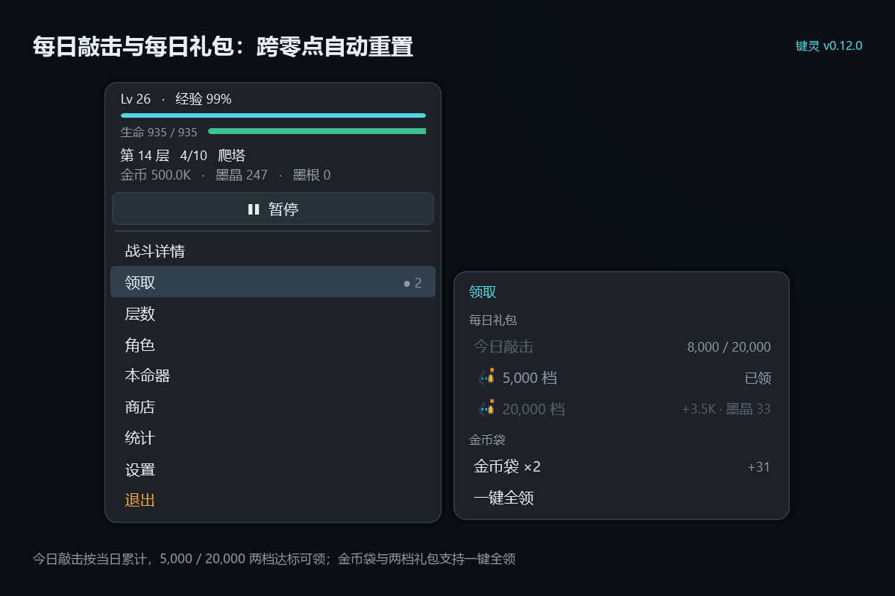
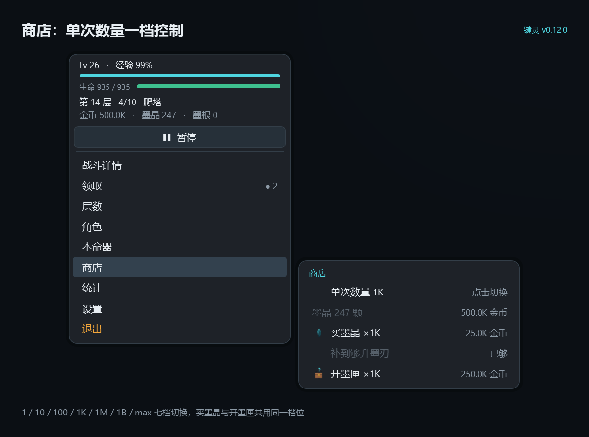
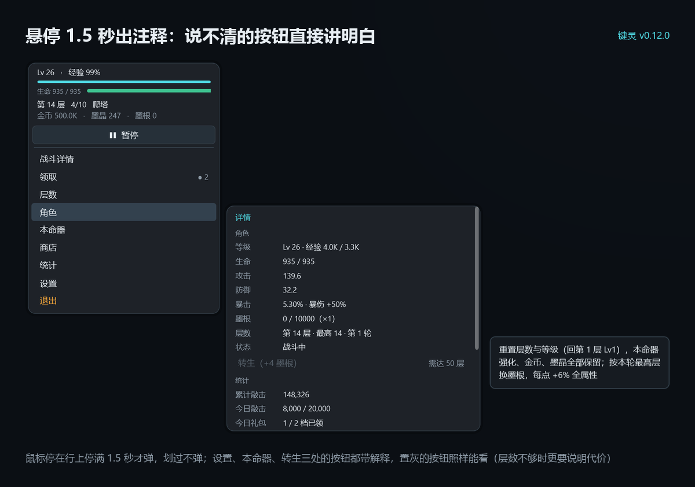
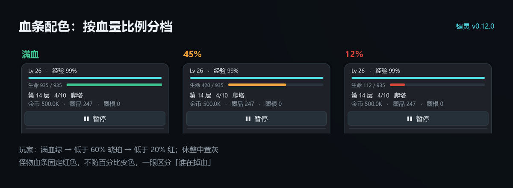
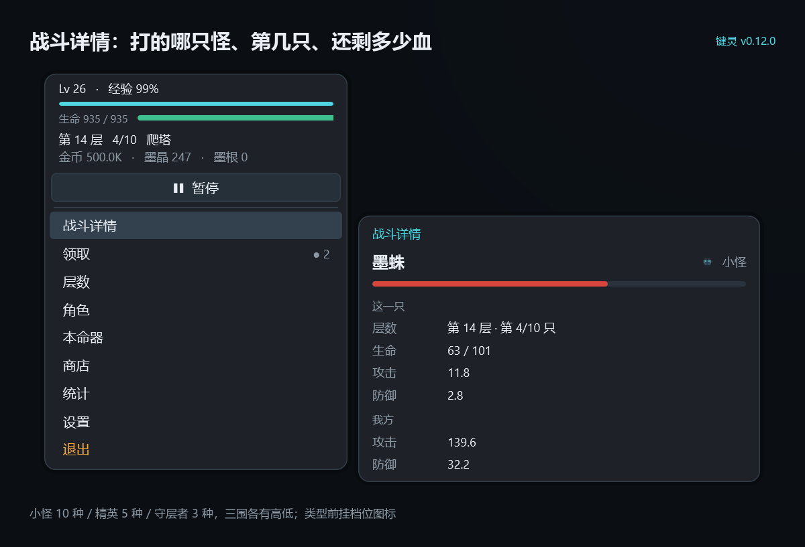

# 键灵 v0.12.0 发布说明

| 项目 | 内容 |
| --- | --- |
| 版本号 | 0.12.0 |
| 发布日期 | 2026-11-04 |
| 版本性质 | 首个公开版本 |
| 运行平台 | Windows 10 / 11（x64） |
| 分发形式 | 免安装绿色版，自包含单文件，无需预装 .NET |
| 存档位置 | `%LocalAppData%\KeySpirit\save.json` |

---

## 一、概述

键灵是一款常驻 Windows 系统托盘的挂机游戏。程序不创建主窗口，不占用任务栏，全部界面以仿系统右键菜单的自绘面板呈现，通过托盘图标唤起。

玩家无需持续操作：角色按固定节奏自动战斗、自动推进层数；玩家仅需在需要决策时打开面板，完成强化、采购、层数调度等动作。本版本为首个公开版本，包含完整的爬塔循环、本命器强化、双层货币经济、层数控制与转生系统，并附带内置教程。

## 二、玩法内容

| 系统 | 说明 |
| --- | --- |
| 爬塔 | 共 10,000 层，每层 10 只怪物，小怪、精英、守层者交替出现；第 10,000 层为终局战斗，通过后层数回卷并开启下一轮 |
| 怪物种类 | 每层 10 只分属三档共 18 个物种：小怪 10 种、精英 5 种、守层者 3 种。同档之间存在血量、攻击、防御的细微差异，而同层 10 只的合计强度恒等于基准值，因此物种差异只改变单只的手感，不影响推层速度。物种按层号与层内序号确定性挑选，同一只怪不会中途改名 |
| 本命四器 | 墨刃、墨衣、墨眸、墨印四件装备，不可更换、不可卸下，唯一成长途径为强化；强化等级无上限，支持单次 ×1 / ×10 / ×50 / ×100 / max 五种批量模式 |
| 经济 | 金币为唯一基础货币，用途仅为兑换墨晶；墨晶用途仅为强化。金币不设其他出口，避免货币体系分叉 |
| 墨匣 | 以金币购买的随机奖励箱，产出金币或墨晶，各档概率在界面内公示 |
| 商店批量 | 商店以「单次数量」档统一控制买墨晶与开墨匣的数量，档位为 1 / 10 / 100 / 1K / 1M / 1B / max；`max` 按当前金币买得起的最大量执行，上限 10 亿 |
| 层数控制 | 提供持续爬塔与定层驻守两种推进模式，支持跳转至本轮已通关层数、设置驻留层书签，并配有自动下潜、自动回退、锁层三项开关 |
| 力竭机制 | 生命值归零后进入休整，休整期间不参与战斗；生命值上限随等级与强化提升，但提升过程不再回复当前生命值 |
| 转生 | 重置层数与属性，保留全部货币，换取永久基础属性「墨根」 |
| 敲击奖励 | 通过 RawInput 统计键盘敲击次数，每 300 次掉落一个金币袋，袋内奖励与当前层数、等级挂钩；可在设置中关闭 |
| 每日敲击 | 单独统计当日敲击数，按本地日期跨零点自动归零；当日达 5,000 次与 20,000 次可各领取一次每日礼包，奖励为金币与墨晶，两档互不影响。进度可在「统计」页查看 |
| 每日礼包 | 领取入口位于「领取」子菜单，两档各一行；未达档位灰显并给出奖励预览，未领取的档位在跨零点后重新开放。金币按当前层与等级折算，墨晶随本轮最高层增长并设上限 |

### 每日敲击与每日礼包

当日敲击数在「领取」页顶部实时显示，进度以「已敲 / 下一档门槛」呈现；两档达标后各领一次，互不影响。

### 商店单次数量

买墨晶与开墨匣共用同一档位，切一次同时作用于两行；买不起时该行灰显并提示「金币不足」。

## 三、界面与交互

面板完全自绘为 Windows 传统右键菜单形态，不含任何 XAML 布局，亦不创建独立窗口。

- 主列宽 232 DIP，行高 21 DIP，正文 10 px，整行高亮，右侧以 ▸ 标示含子菜单项。
- 主列「战斗详情」为功能项第一项（开始/暂停之下、领取之上）。子页显示当前怪物的名称与类型、本层第几只（`第 N/10 只`）、剩余生命与血量条、攻击与防御，并附我方攻防作为对照。类型文字前有一枚档位图标（小怪 / 精英 / 守层者各一张，见 Assets 内 `mob-*.ico`），怪物血量条固定为红色。该页为只读页，不含可点击行。
- 面板自光标位置弹出；下方或右侧空间不足时自动向上、向左翻转。
- 子菜单悬停 0.24 秒后展开，默认弹出于左侧；高度按内容自适应，上限为主列高度的 90%，超出部分在子列内滚动。
- 设置、本命器、转生三处的按钮带注释气泡：光标在行上**停满 1.5 秒**才弹，未满即移开则作废。切页悬停仍是 0.24 秒，两套计时器相互独立，动作不会被说明文字拖慢。置灰的按钮（墨晶不足、层数不够转生）照样能看注释——那种时候更需要说清缺什么、代价是什么。气泡为独立窗口，不抢焦点、不进 Alt+Tab、点击直接穿透；切页、点击、子列重建与关闭面板时立即收起。

- 头部固定五行：等级与经验百分比、经验条、生命数值与血量条、层数与战斗状态、三种货币。血量条按比例分三档：高于 60% 为绿色，低于 60% 转为琥珀色，低于 20% 转为红色；休整期间统一显示为灰色。

- 鼠标悬停托盘图标时弹出只读提示，显示层数、生命、状态与待领取奖励；该提示不抢占焦点，且支持点击穿透。
- 面板失去焦点后自动收起；双击托盘图标可开关面板。
- 内置教程页为本地静态 HTML，优先使用系统 WebView2 渲染，缺失时回退至默认浏览器打开。

### 战斗详情

主列第一项，读取当前正在打的这一只：物种名、档位图标、本层第几只、剩余生命与血条，并附我方攻防对照，用来判断「打不打得动」。该页只读，不含可点击行。

## 四、本版本修复

| 问题 | 说明 |
| --- | --- |
| 强化与升级后生命值回满 | 强化与等级提升原先会将当前生命值直接拉至新上限，导致连续强化等同于无限续航，力竭机制失效。现调整为仅提升上限、不回复当前值，超出上限时按上限截断；会回满生命值的场景仅剩新建存档、转生、休整结束三种 |
| 力竭休整缺少倒计时 | 头部状态标签与角色详情「状态」行现均显示剩余时间（如 `休整 1m59s`），每秒刷新 |
| 打开「统计」时「角色」行被连带高亮 | 「角色」与「统计」是并列主项，不应同亮。现高亮严格限定为当前打开的那一项，打开「统计」时只有「统计」亮。同时将当前页底色调亮，与悬停色区分 |
| 切换子菜单时面板整块闪动 | 分层窗口每次改变尺寸都会触发 DWM 重建合成表面，重建完成前的帧为空。现改为弹出时一次性将窗口包围盒撑至最大尺寸，切换页面仅调整内部布局，不再调用 `SetWindowPos` |
| 敲击次数统计翻倍 | 单次按键会产生按下与抬起两条 RawInput 消息，原先两条均计数。现仅统计按下事件 |
| 墨晶不足仍可批量升级 | ×10 / ×50 / ×100 原先在墨晶不足时按可支付数量降级执行。现改为硬性门槛：不足时提示「墨晶不足」并禁用，同时预先显示总价与「够 ×N」 |
| 子菜单超出屏幕、面板整体位移 | 主列位置仅在弹出时依据光标计算一次，此后不再变动；下方空间不足时仅上移子菜单，使其底边贴合工作区底边 |
| 高 DPI 下弹出位置偏移 | 原实现混用物理像素与 DIP。现统一以窗口 DPI 换算 |
| 单文件发布后菜单图标缺失 | 自包含单文件默认将 `Assets` 内图标打入可执行文件，而运行时按文件路径读取。现配置图标强制保留于可执行文件同级目录 |
| 本命器属性预览不随次数档变化 | 属性预览行原先恒按「涨一级」绘制，导致 ×10 / ×50 / ×100 / max 与 ×1 的预览完全相同，看起来像档位没有生效。现按当前档位实际可升级数的终点值绘制（如 ×10 显示 `攻击 13.4 → 24`），墨晶不足时只显示当前值 |
| 商店批量入口分散 | 原先「买墨晶 ×1 / ×10」「开墨匣 ×1 / ×10」四行并列，档位与商品混在一起。现统一为一行「单次数量 1 / 10 / 100 / 1K / 1M / 1B / max」，同时作用于买墨晶与开墨匣。批量开匣改为只写一行汇总日志；单个批次超过 2000 个时改用多项分布的正态近似抽样，避免大数量卡死界面 |
| 每日礼包无入口 | 每日礼包原为设计稿中的占位项，未接入敲击计数与发放，菜单里也看不到。现补全当日敲击统计、跨零点重置、两档领取与进度显示 |
| 无法查看当前战斗对象 | 此前菜单里只有「层数 · 第 N/10」两个数字，看不出在打什么、它有多少血、自己打不打得动。现新增一级项「战斗详情」，同时为怪物引入物种与三围差异（见第二节「怪物种类」） |
| 血条配色不足以区分敌我 | 原先敌方血条为琥珀色，与玩家「低血警示色」同色，一眼看去分不清是我方告急还是怪物血条。现怪物血条固定红色；玩家血条按 60% / 20% 两条线分绿、琥珀、红三档 |
| 怪物档位只靠文字区分 | 小怪、精英、守层者原先只有文字标签，扫视时不易分辨。现为三档各绘一枚像素图标，置于类型文字之前 |
| 每日礼包进度文案自相矛盾 | 当日敲击已过最高档、但两档都还没领时，进度行原先显示「21,360 · 已全领」，而下面两行明明都可点。旧逻辑只判「未领且未达标」，两档都达标时循环走完直接落到「已全领」。现按三种状态分别措辞：有可领档 → `可领 N 档`；还有未达档 → `已敲 / 下一档门槛`；全部领完 → `已全领` |

## 五、性能

- 常驻内存由 864 MB 降至约 115 MB（软件渲染模式下稳定，展开子菜单瞬时约 147 MB 后回落）。
- 空闲 CPU 占用 0 ~ 0.5%。
- 界面仅在打开时绘制，不含逐帧动画，因此软件渲染无可见代价。如需尝试硬件渲染，可设置环境变量 `KS_HW_RENDER=1` 后启动。

## 六、运行要求

- 操作系统：Windows 10 / 11，64 位。
- 运行库：发布包为自包含单文件，无需预装 .NET。
- 磁盘：解压后约 67 MB。

## 七、已知问题

1. **可执行文件未做代码签名**，首次运行时 Windows SmartScreen 可能提示「未知发布者」，需选择「更多信息 → 仍要运行」。
2. 界面强制使用软件渲染，以降低内存占用；此为本版本的既定设计，非缺陷。
3. 教程页依赖系统 WebView2。缺失时将回退至默认浏览器打开，功能不受影响。

## 八、说明

本版本的程序代码、部分美术素材及部分策划框架由 AI 生成，人工负责需求确认、规则取舍、缺陷复现与回归验证。项目内置 81 项自测断言，覆盖大数显示、数值封顶、怪物曲线与物种表、战斗结算、金币袋、商店、墨匣、强化连升、层数跳转、转生、每日敲击与礼包、存档与面板状态。

> 转生代价（墨渊税）为本版本策划稿中的新增设计提案，尚未实装于本版本程序，详见策划稿 6.7 节。
