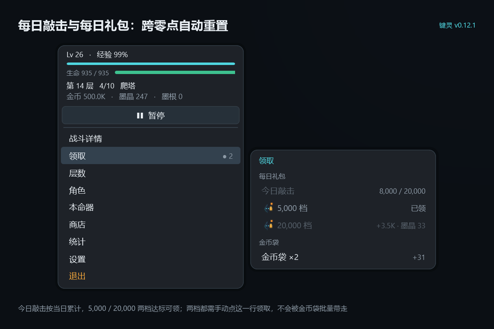

# 键灵 v0.12.1 发布说明

| 项目 | 内容 |
| --- | --- |
| 版本号 | 0.12.1 |
| 发布日期 | 2026-11-05 |
| 版本性质 | 缺陷修复版（无新增玩法） |
| 运行平台 | Windows 10 / 11（x64） |
| 分发形式 | 免安装绿色版，自包含单文件，无需预装 .NET |
| 存档位置 | `%LocalAppData%\KeySpirit\save.json` |

---

## 一、概述

本版本只修一个缺陷：**每日礼包可以被批量代领**。

v0.12.0 的「领取」页底部有一条「一键全领」，它的本意是省掉连续点金币袋的麻烦，但实现上把当日两档每日礼包也一起领掉了。结果就是玩家只要按一下，两档礼包就同时入账，等于「自动领取」——礼包该有的「自己点一下才拿到」的过程被跳过。本版本撤掉这条批量入口，每日礼包恢复为**必须逐档手动领取**。

## 二、本版本修复

| 问题 | 说明 |
| --- | --- |
| 每日礼包可被「一键全领」批量代领 | 「领取」页底部的「一键全领」会在一次点击里领走金币袋与当日两档礼包（5,000 / 20,000），玩家无需分别确认，效果等同于自动领取。现撤除该行：每日礼包只能点各自的档位行领取，金币袋仍由「金币袋 ×N」一行一次全部入袋。两档礼包行新增悬停 1.5 秒注释，说明「需手动点这一行，不会被金币袋批量带走」 |

### 改后的领取页

每日礼包两档各占一行，达标后需各自点击才入账；金币袋单独一行，点一次领完所有待领袋。

## 三、兼容性

存档结构未改动（`DailyKeys` / `DailyDate` / `DailyMask` 三个字段与 v0.12.0 一致），可直接覆盖安装，无需迁移，已领的档位、待领的金币袋都保留。

## 四、说明

本版本的修复由 AI 编写代码，人工负责缺陷复现、规则确认与回归验证。项目内置 85 项自测断言（上一版为 81 项，本版新增 4 条覆盖「礼包不会被批量领走」），覆盖大数显示、数值封顶、怪物曲线与物种表、战斗结算、金币袋、商店、墨匣、强化连升、层数跳转、转生、每日敲击与礼包、存档与面板状态。

> 转生代价（墨渊税）仍为策划稿中的设计提案，尚未实装于程序，详见策划稿 6.7 节。
