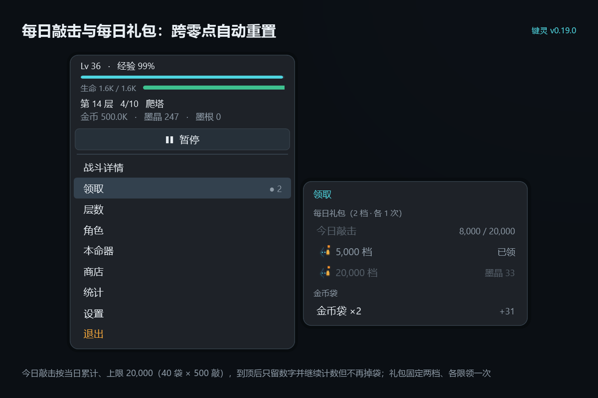
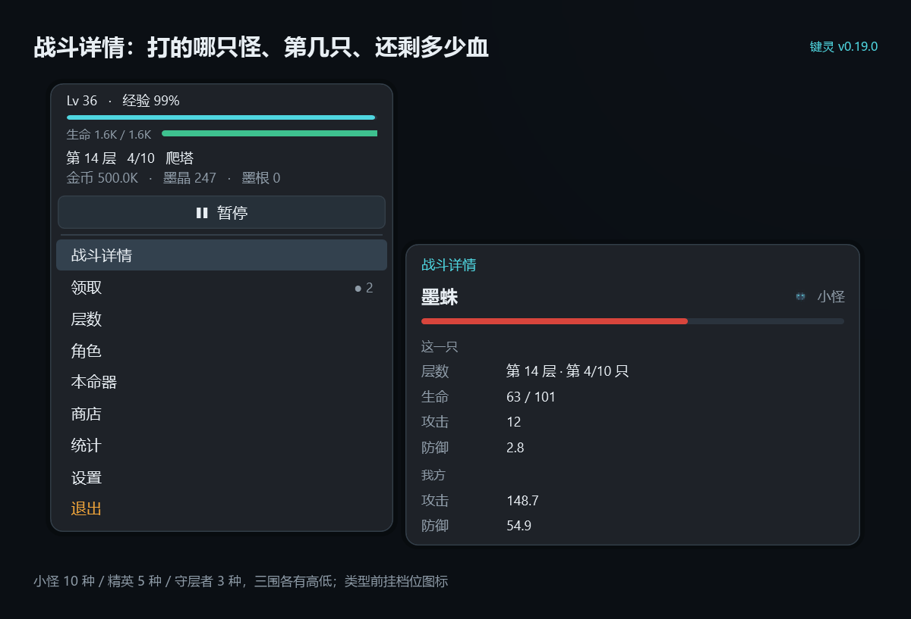

# v0.19.0 —— 拆掉「等级 = 层数 × 3」的自动变强轨道

> 起因：「我刚才删档重来了一次，没有任何操作和升级，直接就能升到两百多级爬到 72 层。这不太对吧？」
>
> 追问后定的方向：「按乙走，但是生命值乘区不要降太多，攻击力乘区可以多降。本质上是要越来越刮痧」

## 一、先确认：这不是手气问题，是公式算死的

一层 10 只怪的经验当量是 **8 只小怪 + 1 只精英 + 1 只守层者**。v0.18.3 里精英 = `max(1.5, k×0.5)`、守层者 = `max(3, k)`，所以：

```
一层当量 = 8 + 0.5k + k = 8 + 1.5k
升一级要 = k
一层级数 = 8/k + 1.5  ≥  1.5        ← 无论 k 多大，地板就是 1.5 级/层
```

**每层至少升 1.5 级，数学上不可能更低。** 于是等级被锁死成层数的 2.5~3 倍：72 层必然 200 多级，1000 层必然 1500 级。等级不表达任何玩家的选择，只是「你走了多远」的换算尺。

v0.13.0 把「需求挂到层数」之后，这条副作用就一直存在，只是前几版没人从头挂一遍机，没露出来。

实测（删档、零操作、零强化、不领礼包、2 秒/回合）：

| 层数 | 用时 | 等级 |
|---|---|---|
| 10 | 9 分钟 | 37 |
| 30 | 19 分钟 | 101 |
| 50 | 35 分钟 | 159 |
| **72** | **70 分钟** | **219** |

## 二、第二个问题：前 90 层根本不需要操作

原因不是「升级太快」，是三条曲线只有一个交点：

- 玩家攻击 = 本体攻（线性）× 等级乘区（线性）= **对等级二次增长** ≈ `0.015 × 级²`
- 等级 ≈ 3 × 层数 → **攻击 ≈ 0.135 × 层数²**
- 怪血 = `50 × 1.06^层`，**指数**

二次和指数只有一个交点，实测落在 **85~90 层**。交点之前二次曲线一路跑赢，玩家什么都不用做就能推；交点之后一次反转，变成「休整 → 退层 → 再休整」的死循环。中间那段「逐渐吃力、需要强化」的斜坡**不存在**——而那段斜坡才是玩家该做决策的地方。

## 三、改法（表里的数都是常量，一处一个）

| 位置 | v0.18.3 | v0.19.0 | 为什么 |
|---|---|---|---|
| `ExpKillsSlope` | 0.58 | **1.6** | 一级要打的只数涨得更快，一层给的级数才压得下来 |
| `EliteExpMul` | `max(1.5, k×0.5)` | **常数 2** | 拆掉 1.5 级/层的地板（关键的一刀） |
| `KeeperExpMul` | `max(3, k)` | **常数 4** | 同上 |
| 等级乘区 `LvMul` | `1 + 0.015×(级−1)` | **`1 + 0.015×√(级−1)`** | 攻击从二次增长压到近线性 → 每只怪的回合数随层数单调上升 |
| `LvAtkGain` | 1 | 1（不动） | 前期攻击主要来源，砍它会毁开局手感 |
| `LvHpGain` | 10 | **18** | 击杀回合变多 = 挨打次数变多，血必须变厚 |
| `LvDefGain` | 0.5 | **0.9** | 同上，防御也抬 |

**为什么是压指数而不是砍系数**：砍系数（把 +1 攻/级 砍成 +0.3）会把前 10 层一起砍死——开局就变 8 回合一只怪，前 5 分钟直接闷掉。压指数是「1 级时几乎不变、等级越高每级越不值钱」，正好就是「越来越刮痧」。

**为什么攻击降、生命反而升**：这两件事是一体的。击杀要 20 回合，就意味着要挨 20 次打；血不跟着厚，刮痧立刻退化成「一碰就死 + 力竭循环」。所以攻击乘区压到平方根，血/防加点反向抬近一倍。

## 四、改完长什么样（零强化实测）

| 层数 | 等级 | 攻击 | 生命 | 一只小怪 | 一条命能撑 |
|---|---|---|---|---|---|
| 10 | 27 | 49.5 | 688 | **2 回合** | 1485 回合 |
| 30 | 58 | 85.7 | 1.2K | **4 回合** | 706 回合 |
| 50 | 81 | 113 | 1.7K | **8 回合** | 183 回合 |
| **72** | **102** | 139 | 2.0K | **24 回合** | 36 回合（≈1.5 只） |
| 100 | 125 | 168 | 2.5K | **108 回合** | 5 回合 |

- **等级/层数** 从 3 : 1 落到 **1.4 : 1**（72 层 102 级），386 层 281 级、9999 层 1652 级。
- **每层级数** 从「永远 ≥1.5」变成 `14/k`：1 层 3.9 级、72 层 0.90 级、386 层 0.42 级、9999 层 0.086 级。
- **零操作** 约 6 小时后仍在 65~68 层徘徊，**到不了 72 层**；想去更深，必须花金币 → 买墨晶 → 点墨刃。
- 点完墨刃 52 级（≈66 墨晶，几十层就能攒出来），72 层的「24 回合」回到 **8 回合**——**磨得动，但慢**。

这就是「越来越刮痧」的形状：前期 2 回合爽快，中期 8 回合，后期 20 回合往上，想维持节奏只能一直强化。挂机游戏的正确节奏也回来了：**挂机产资源 → 资源换强度 → 强度换层数**，而不是「挂着自动变强、玩家只需要看」。

## 五、影响与代价

- **老档等级不会掉，也不需要迁移**（Schema 仍 3）。新曲线下 72 层应得 102 级，老档可能留着 219 级——但等级乘区已经是平方根，219 级只 ×1.22（vs 102 级 ×1.15），差 6%；本体攻多 117 点，在墨刃的几千点面前可以忽略。**结论：留着无害，不折腾玩家**。
- **整体节奏变慢**：同样 12 小时，旧版自动强化能到 201 层，新版 120 层左右。这是刻意的——旧版那 201 层里有 90 层是白给的。
- **「一层 3 分钟」变成「一层 8 分钟」**，转生提示（连续 3 层 > 10 分钟）会比以前更早亮。设计稿 3.6 的表已注明基数 ×2.5。
- **新手引导的文案不用改**：升级仍然变强，只是不再「一级顶十层」。

## 六、如果想再调

只有三个旋钮，改完跑 `--selftest` 就能看曲线：

| 旋钮 | 调大 | 调小 |
|---|---|---|
| `ExpKillsSlope`（1.6） | 等级更少、更刮痧 | 等级更多、回到记分牌 |
| `LvMul` 里的 0.015 | 攻击涨得快、刮痧感减弱 | 更刮痧，但前期也会变钝 |
| `LvHpGain` / `LvDefGain`（18 / 0.9） | 更能磨，但可能「越深越安全」 | 更脆，力竭变多 |

## 七、自测

**174 项全过**（原 175：删掉 3 条按 `k` 缩放时代的断言，新增 2 条锁定新结构）。

新增的两条是防回归的：

```csharp
Check("精英 ×2、守层者 ×4 是常数，不随层数缩放", ...);
Check("一层给的级数随深度递减（72 层 0.9 级 / 3000 层 0.16 级，没有 1.5 地板）", ...);
Check("攻击等级乘区按平方根走（899 级 ×1.45，不再是 ×14.5）", ...);
```

另有三条随常量同步改口径：生命/防御「899 级只多本体 LvHpGain×899 点」改为读常量（不再写死 8,990 / 449.5），迁移曲线断言改为「386 层 ≈ 281 级 / 9999 层 ≈ 1652 级」。

## 八、改到的文件

- `Core/Game.cs`：`ExpKillsSlope` 1.6、`EliteExpMulConst` / `KeeperExpMulConst`、`LvMul` 改平方根、`LvHpGain` 18、`LvDefGain` 0.9、`LvCapAt` 用常数、相关注释全部重写；
- `SelfTest.cs`：3 条改口径 + 2 条新增，共 174 项；
- `Shot.cs`：演示档 14 层从 Lv78 改成 Lv36（`LvCapAt(14)`），否则截图是旧曲线的假数字；
- 文档：`键灵_策划设计稿.md`（4.0 属性总式、4.1 等级全节、3.4 怪物表、3.6 耗时基数、迁移表、术语表、验收项）、`CHANGELOG.md`、`README.md`（174 项）、本文件。

## 九、这一版是「跳 11 版」，顺手把界面也一起看一遍

上一版发布是 **v0.14.0**。之后 v0.14.1 到 v0.18.3 这十版一直在本地跑，这次和 v0.19.0 一起上。其中三处是**眼睛能看出不一样**的，配图为 v0.19.0 实际运行截图。

**① 今日敲击与每日礼包**（v0.17.1）：分母固定为今日上限 20,000（40 袋 × 500 敲），敲到顶去掉分母只留数字、继续计数但不再掉袋；「金币袋 ×N」的袋数由敲击数派生，重开不会丢零头。礼包标题写明「2 档 · 各 1 次」——每天固定两个，5,000 档给金币、20,000 档给墨晶。



**② 战斗详情**（本版）：同样的 14 层，等级从 78 掉到 36，攻击 148.7、防御 54.9——这正是「等级不再是白送的强度」在面板上的样子。



**③ 科学记数法三位小数**（v0.18.2 → v0.18.3）：数字由 `9.9e+15` 变 `9.940e+15`，1 位时墨衣连升十几级面板一动不动，看不到每级 6% 的涨幅；但**只留给详情页**（角色 / 战斗 / 本命器预览），主列血条旁仍是 1 位——三位会把血条挤短。

另外两处数值口径的变化不看图也能感觉到：**暴伤**改「+0.1%/级、无上限」（v0.16.1，此前 1%/级封顶 +400%），**数值上限**从 10,000 放到 10 万层（v0.17.0，1.8e+3000）。

## 十、验证方式

`--selftest` 174 项全过；`--shot` 离屏出图核对主列（血条完整）、战斗详情、角色详情（`+1 攻 · +18 血 · +0.9 防`）、本命器预览（攻击 148.7 → 154.6）、商店（「补到够升墨刃 / 已够」）。全程未启动窗口、未模拟鼠标、未读写真实存档。
