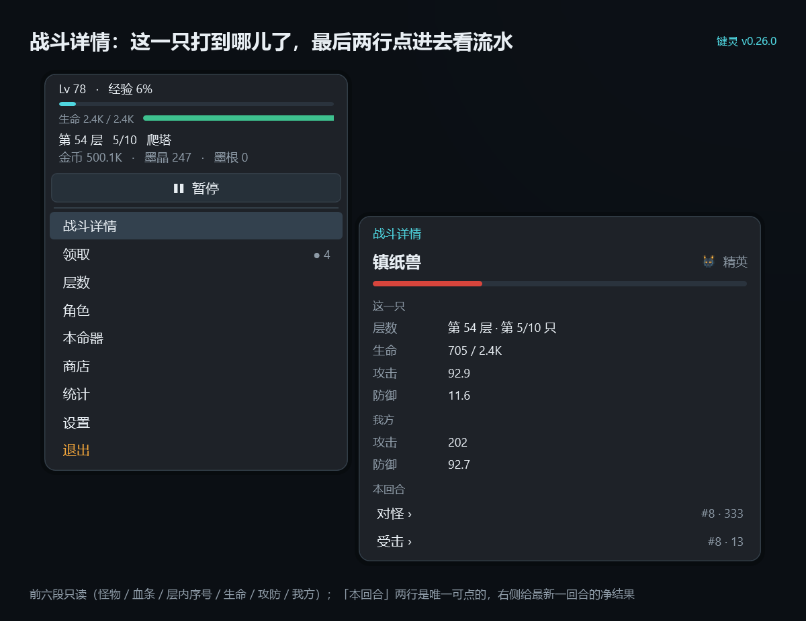
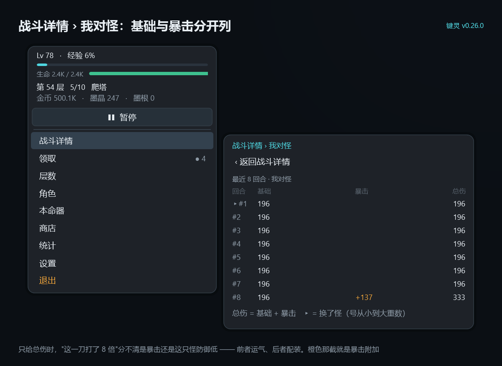
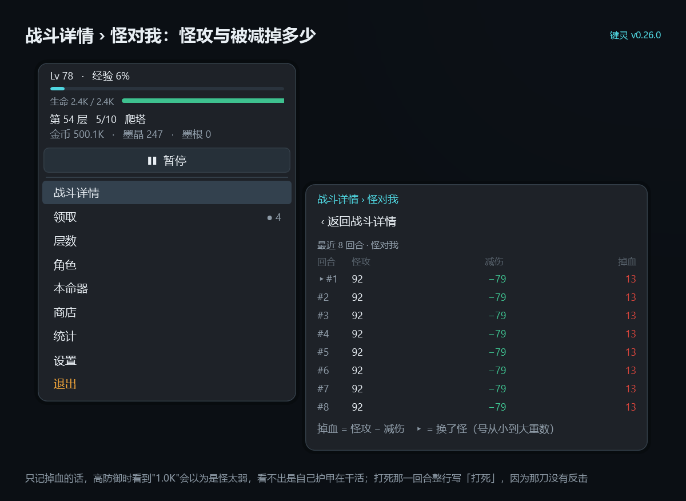

# v0.26.0 —— 回合流水拆成「我对怪 / 怪对我」两个三级页，记录改成分项结构

> 起因：「我本来想的是只显示当前回合。你这样显示多个回合的也可以，不过要显示在 3 级菜单里，入口就是显示当前回合的那一行。另外，这只有角色对怪的，还有怪对角色的也加上。这俩在 2 级菜单里是单独的一行，三级菜单也是不同的。注意未来可能加上其他参数（比如吸血、闪避等），所以要做好规划。」

v0.25.0 把 8 回合的两方向流水直接铺在「战斗详情」页上。那一版有三个问题：二级页本来该一眼读完，塞了 8 行就变成要看表；两个方向的列不是一回事，挤在一张表里读不出；而且只有「我打怪」，没有「怪打我」。

## 一、二级页只留「本回合」两行

```
战斗详情
  这一只   层数 / 生命 / 攻击 / 防御
  我方     攻击 / 防御
  本回合
    对怪 ›            #7 · 1.8K
    受击 ›            #7 · 42
```

这两行是这一页**唯一可点**的，右上是**最新一回合的净结果**。点进去是各自的三级页。



**预览只给净结果、不给分项**：分项要带颜色才读得懂，而一行的右侧提示只有一个 TextBlock、一种颜色。硬拼成 `1.8K +590` 反而让人以为 +590 是加在净结果上的——它本来就是净结果的一部分。

## 二、两个三级页，各看各的列

```
战斗详情 › 我对怪               战斗详情 › 怪对我
回合   基础   暴击   总伤        回合   怪攻   减伤   掉血
#1     1.18K   —     1.18K      #1     45    −3     42
#2     1.18K  +590   1.77K      #2     45    −3     42
#6     1.18K   —     1.18K      #6     —      —     打死
```

**为什么必须两页**：`我对怪` 要看的是基础与暴击（配装 vs 运气），`怪对我` 要看的是怪攻与被减掉多少（护甲够不够）。挤在一张表里就是四列数字并排，谁也读不出谁；拆开之后每页三小列，一眼能读。

两页读的是**同一条** `RoundHit`，所以同一个 `#N` 在两页里对得上，不用玩家自己拼回合号。三级页顶部有 `‹ 返回战斗详情`，主列上仍然只有「战斗详情」那一项亮着（跟「设置 › 危险操作」同一套约定）。

颜色：暴击附加橙、减伤绿。不是装饰——「多打了」是运气、「少挨了」是护甲在干活，两种要能一眼分开。





## 三、记录结构改成分项（为吸血、闪避留位置）

以前一条记录是四个固定字段（`Base / Crit / Taken / Killed`），加一种新伤害就得改结构、改界面、改自测。现在两侧各是一串分项：

```csharp
public enum HitKind { Base, Crit, Mitigate }        // 只增不改，新机制加在末尾
public readonly record struct HitPart(HitKind Kind, Big Amount);   // 数值恒非负

public sealed class RoundHit
{
    public int No; public bool Killed;
    public Big DealtTotal, TakenTotal;              // 净结果单独存
    public List<HitPart> Dealt, Taken;              // 两侧各一串分项
}
```

**净结果单独存、不按分项求和**，这一点是为了以后：

- 吸血：算回血，不该加进对怪伤害；
- 闪避：数值是 0，但界面还是要显示一行「闪避」。

如果总数写成「分项相加」，这两种一加进来就会算错。现在三项恰好满足「对怪 = 基础 + 暴击」「掉血 = 怪攻 − 减伤」，但那是当前机制的巧合，不写成不变式。

加机制的固定三步：

1. `HitKind` **末尾**追加一项（不插中间、不改已有数值）；
2. `ResolveRound` 里往对应一侧 `Add` 一条；
3. 界面 `HitStyle()` 里登记「符号 + 颜色」，**不登记也能跑**（回落默认样式）。

界面一侧也做了同样的准备：每行的「附加」格留了 `HitPartsMax − 1 = 2` 个坑，一个坑一个 TextBlock。超出的分项不画（记录里仍在），加机制时把常量一起调。

## 四、数值一个都没动

这一版只改「怎么记、怎么显示」：伤害公式、受击公式、暴击率、怪物曲线、金币经验掉落全部原样。同样的存档打同样的层，数字完全一样，只是终于看得见每一刀是怎么来的。

## 五、自测

`199 → 201` 项，全过。这一块重写了 8 条：

- 对怪侧：基础 + 暴击附加 = 总伤，基础恒为正；
- 暴击附加只在对怪侧、只在暴击那回合，且必为正；
- 受击侧：怪攻 − 减伤 = 掉血，掉血恒为正；
- 致死那一刀受击侧为空（界面写「打死」而不是「掉血 0」）；
- 流水只留最近 8 条；每侧分项不超界面能画的 3 个坑；
- 换怪保留上一只的最后一刀、新一只从 `#1` 重新数；
- `LastHit` 指向最新一回合（二级页那两行读它）。

一个踩到的坑记在这里：**`(a − b) + b` 在 `Big` 上不保证等于 `a`**（尾数只有 7 位）。第一版断言写的是精确相等，三条直接 FAIL——是断言错，不是代码错。现在按 `log10` 相对误差 < 1e-6 判，比界面上任何一位都小。

## 六、影响范围

- `Core/Game.cs`：`HitKind` / `HitPart` / `RoundHit` 重写，`RoundHits`、`LastHit`、`HitPartsMax`，`ResolveRound` 两侧各记一串分项；
- `UI/PanelWindow.cs`：`BuildBattle` 只留「本回合」两行 + `FightEntry`；新增 `BuildFightLog`（两个三级页共用一套，`outbound` 决定列头与颜色）+ `HitStyle`；路由加 `battleOut` / `battleIn`，`PageKey` 与 `IsMainActive` 都归到「战斗详情」；
- `SelfTest.cs`：这部分 6 条重写成 8 条（总数 199 → 201）；
- 设计稿 8.2 / 8.3 同步重写。

## 七、这一批一起发布的版本（v0.20.0 ~ v0.25.0）

上一次发布是 v0.19.0，之后的七版一直只在本地。这里按时间列一遍，方便对照：

| 版本 | 改了什么 |
|---|---|
| v0.20.0 | 转生获得的墨根减半（`0.35 → 0.175 × 最高层`）、每点加成 `1.06 → 1.05` |
| v0.21.0 | 转生终于有代价：四件本命器一起归零、解锁线改成 `50 + 25 × 转生次数`、强化成本 `1.07 → 1.08` |
| v0.22.0 | 详情页把墨根加成逐行拆开：生命/攻击/防御各挂一行 `墨根 +N`（总量 ×(1 − 1/乘区)） |
| v0.23.0 | 精英与守层者补齐**攻防档位倍率**：此前只有血量有倍率，攻防从来没乘过，三档怪在详情页上数字一字不差；现为精英 2.0/1.15/1.1、守层者 4.0/1.6/1.3 |
| v0.24.0 | 每日礼包改按「折合几级强化」定标（5,000 档 14 级、20,000 档 20 级），折级不随层数漂移；金币袋袋值 `1.25 → 1.15` |
| v0.24.1 | 商店「补到够升墨刃」补上「金币不足」：这一行此前只看墨晶缺口，金币差几个数量级也照样白字可点，点下去静默无反应 |
| v0.25.0 | 战斗详情新增回合流水（最近 8 回合） |

其中 v0.24.0 那一条是这次唯一「数值看得出来」的改动：


旧口径是 `clamp(30 + 最高层/4, 30, 150)`——线性、480 层封顶、此后永远 150 颗。以墨刃等级反算「领一次能升几级」：336 层只够 0.00006 级，等于空包；1000 层照样 150 颗。现在两档都问「该值几级强化」再乘回成本，多深都是 14 / 20 级。
